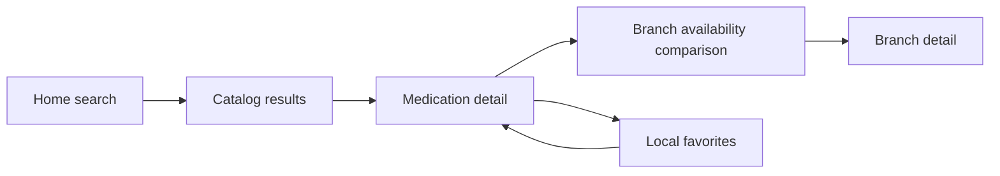
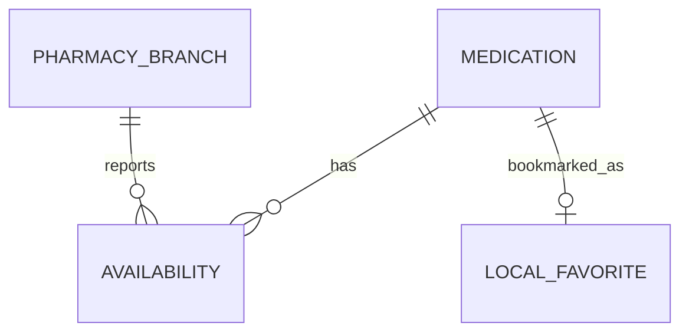
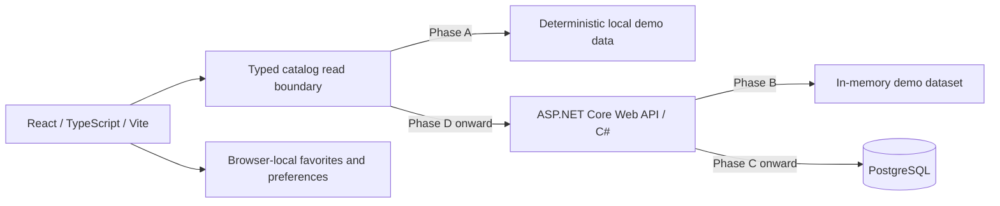

# PharmaFlow — Product Plan

Status: full-stack target architecture confirmed; implementation remains unapproved.  
Planning date: October 4, 2026.  
Deliverable for this task: this document only. No application, packages, Git repository, commits, or deployment are created.

## 1. Executive summary

**PharmaFlow is an independently designed, fictional public medication discovery platform that lets people search a catalog, compare demonstration availability and reference prices across pharmacy branches, and bookmark medications locally without an account.**

The target architecture is React + TypeScript + Vite, an ASP.NET Core Web API written in C#, and PostgreSQL. Phase A validates a frontend-only experience with deterministic local fictional data; phases B–E introduce the API, persistence, integration, and full-stack verification. The functional MVP retains five polished workflows: discovery, medication detail, branch comparison, branch inspection, and favorites. It prioritizes understandable information, accessible interaction, and an honest distinction between demonstration data and real pharmacy services. English is the initial interface language; the architecture supports Spanish and Japanese progressively.

## 2. Product purpose

Help a visitor answer “What catalog item is this, where does the demo show it available, and how recently was that information recorded?” with minimal navigation. Present general catalog attributes without interpreting symptoms, recommending treatments, or substituting one medication for another.

Success means a complete, coherent demonstration that recruiters can explore quickly, with engineering decisions visible through behavior and documentation rather than through a large feature count.

## 3. Problem statement

Medication discovery becomes difficult when catalog identity, presentation, availability, price, and update time are separated or ambiguous. An availability label without a branch or timestamp is especially easy to misread. PharmaFlow explores how a small public interface can bring these facts together clearly.

This is a fictional design problem, not a claim about a specific organization or evidence of a commissioned service. No real availability need is fulfilled by this prototype.

## 4. Primary persona

**Alex, a member of the public browsing on a phone.** Alex knows a medication name or active ingredient and wants to inspect the matching presentation and compare branches. Alex may have limited time, variable digital familiarity, or use assistive technology. Alex wants information without registration and wants to return to selected items later.

Do not infer Alex's diagnosis, identity, prescription, or eligibility. Staff and administrators are outside the MVP persona set.

## 5. User goals

- Find an item by display/generic name or active ingredient.
- Distinguish strength, form, and package presentation before comparing it.
- Understand available, low stock, unavailable, and missing information at each branch.
- Compare fictional reference prices for the same catalog presentation.
- Inspect the timestamp associated with each branch's availability.
- Read a catalog prescription indicator without treating it as jurisdiction-specific advice.
- Inspect fictional branch locations and schedules.
- Save and remove local bookmarks, then revisit them after a reload.

## 6. Core user journey



Home submits a query to the catalog. Results identify a specific presentation. Detail shows catalog facts followed by the branch comparison. Saving is available on results and detail; Favorites links back to detail. Branch navigation is optional and never required to compare availability.

Preserve catalog query parameters when returning from detail. Empty results offer “Clear filters”; an empty Favorites screen offers a catalog link. Unknown item or branch URLs show a useful not-found screen.

## 7. MVP scope

| Workflow | Included behavior | Completion evidence |
| --- | --- | --- |
| Home | Search first, concise purpose, catalog entry, prominent demo disclosure | Search reaches matching catalog results using keyboard or touch |
| Catalog | Name/ingredient search; branch, availability, and form filters; name and reference-price sorting | Combined filters have deterministic results and can be reset |
| Medication detail | Identity, ingredients, strength, form, presentation, category, prescription indicator | Different presentations cannot be mistaken for a single interchangeable item |
| Branch comparison | Status, fictional reference price, update timestamp, branch detail link | One medication can display different statuses and prices across branches |
| Branches | Directory and detail with fictional location, weekly hours, link to branch-filtered catalog | Visitor can inspect a branch and its catalog without a map service |
| Favorites | Save/remove IDs locally; empty state; clear all | Bookmarks survive reload when storage is available |
| Shared experience | Responsive shell, intentional light/dark themes, accessible controls, English copy | Core flows remain usable with keyboard, zoom, and mobile width |

Home, catalog/detail, branch comparison/inspection, and favorites are the five main experiences; shared capabilities support them. Cap the initial dataset at approximately 24 presentations and three branches. No pagination or infinite scrolling is needed at this size.

## 8. Explicit non-goals

The MVP excludes beneficiary enrollment, RUT/RUN or other identity collection, patient registration, minors' information, clinical history, diagnosis, medical records, prescription or document uploads, proof of address, dosage/treatment recommendations, and appointment scheduling.

It also excludes accounts/authentication, purchases, carts, payments, reservations, delivery, real pharmacy APIs, live stock feeds, administration, ERP/WMS features, receiving, transfers, lots, and dispensing workflows. No geolocation, real maps, real contact details, regulatory-compliance claims, or implied municipal affiliation. A read-only ASP.NET Core API and PostgreSQL persistence are included in the final target, deferred until after frontend validation; they add architectural depth without adding user workflows.

## 9. Proposed routes and screens

| Route | Screen | Key behavior |
| --- | --- | --- |
| `/` | Home | Search submits to `/catalog?q=…` |
| `/catalog` | Catalog | Optional `q`, `branch`, `availability`, `form`, and `sort` parameters |
| `/medications/:slug` | Medication detail | Catalog facts and multi-branch availability in one view |
| `/pharmacies` | Branch directory | Three fictional branches |
| `/pharmacies/:slug` | Branch detail | Location, schedule, branch-filtered catalog link |
| `/favorites` | Favorites | Saved presentations and local-storage explanation |
| `*` | Not found | Recovery links; also used for unresolved detail slugs |

Use stable English slugs across locales. Availability belongs on medication detail, not on a separate screen. Demo/privacy explanations fit in the shell and relevant inline content; no extra informational routes are necessary initially.

BrowserRouter is recommended, subject to a static host that can rewrite direct route requests to the SPA entry. A hash router is a fallback only if the chosen host cannot support rewrites. Deployment is a later task.

## 10. Navigation model

Use **Home · Catalog · Pharmacies · Favorites** as the four primary links. The logo links to Home. Medication and branch detail are contextual destinations, with descriptive breadcrumbs. Theme control is a utility; language selection appears once translated interfaces exist.

Desktop uses a compact horizontal header. Mobile uses a plainly labeled menu with correct expanded state, keyboard behavior, and focus restoration. Favorites may show a count with an accessible label. Avoid sidebars, admin navigation, and hidden core actions.

## 11. Domain model

Each Medication is **one catalog presentation**, not an abstract ingredient. A different strength, pharmaceutical form, or package size gets a different ID. No separate product-family entity is needed for this dataset.

| Concept | Proposed fields | Reasoning |
| --- | --- | --- |
| Medication | `id`, `slug`, `displayName`, `activeIngredients[]`, `strengthLabel`, `formCode`, `presentationLabel`, `categoryCode`, `prescriptionRequired` | Stable identity plus the minimum facts needed to distinguish a presentation. Ingredient arrays support combination entries without an ingredient database |
| PharmacyBranch | `id`, `slug`, `name`, `fictionalLocation`, `openingHours`, `timeZone` | Location is a clearly imaginary district/address; structured weekly intervals can express closed days and split hours |
| Availability | `medicationId`, `branchId`, `status`, `referencePrice`, `updatedAt` | One current demonstration observation per medication/branch pair; composite identity prevents duplicates |
| Favorite | Medication ID in a local set | A bookmark relationship, not an independent domain record or patient entity |

`status` is an explicit union: `available`, `low-stock`, or `unavailable`. **Do not display or store exact quantities in the MVP.** Statuses communicate the intended comparison without false precision or invented inventory thresholds. They are fixture values, not quantities derived by a stock system.

`referencePrice` is nullable and, when present, contains integer minor units and a currency code. Use one approved demo currency throughout; provisional recommendation: USD, clearly labeled fictional. Prices refer to the exact package presentation. Null means “Reference price not provided,” never zero. An unavailable item may still have a reference price, with availability communicated separately.

`updatedAt` is an ISO 8601 UTC instant for the availability observation, including its reference price. Catalog metadata is static; do not imply this timestamp validates medication facts. `prescriptionRequired` is a demonstration catalog flag, explicitly not a legal determination.

Form/category codes map to localized labels. Ingredient names and catalog labels are separately authored domain content, with locale overlays when translations are introduced. No indications, therapeutic advice, contraindications, dosage, or substitutions are modeled.

## 12. Entity relationships and availability semantics



The local-favorite box represents set membership only; it is not a database table. Validate unique IDs/slugs, valid foreign keys, unique medication/branch pairs, nonnegative prices, known currencies/statuses, and valid timestamps when fixtures are authored. Preserve IDs, null semantics, prices, and UTC timestamps through API/database migration. PostgreSQL will enforce foreign keys, unique slugs and medication/branch pairs, and appropriate status/price constraints. Favorites remain outside the database.

Missing availability means **“No demo information”**, not unavailable. With a branch selected, filters and prices refer exclusively to that branch. Without one, an availability filter matches an item if any branch has the selected status; the label explains “At any branch.” Result summaries say, for example, “Available at 1 of 3 branches,” rather than flattening every branch into one misleading status.

Default sorting is name ascending with stable ID tie-breaking. Price sorting uses the selected branch's reference price; without a branch it uses the lowest reference price among available/low-stock branches and labels the value “From.” Missing prices sort last. When no stocked branch has a price, show no aggregate price; branch detail can still show an unavailable branch's reference price. Filters combine with AND. Search uses case/diacritic-normalized substring matching across names and ingredients; no fuzzy matching or medical synonym engine initially.

## 13. Fictional demo-data strategy

Author a small original fixture set rather than scraping, importing, or reconstructing any pharmacy catalog. Prefer generic ingredient names and independently written presentation labels over commercial brands. Familiar names may provide realism, but strength/presentation combinations and prescription flags must be presented as illustrative catalog data, not authoritative medication information.

Use three invented branches, provisionally **Aster Commons**, **Willow Arcade**, and **Lantern Court**, in an explicitly fictional setting called **Demo District**. Locations use descriptions such as “Demo District, imaginary block A”; no plausible real street address, coordinates, phone number, email, logo, or municipal identity. Names are working fiction, not a claim that no similarly named business exists.

Include every status, mixed branch availability, missing prices, one missing observation, combination ingredients, multiple presentations, and differing update times. Keep fixtures deterministic. Maintain one canonical fictional dataset for local reads, API data, and repeatable database seeding; do not maintain independently edited copies. Schema migrations and data seeding are separate concerns; seeding must not duplicate rows or rewrite demonstration timestamps. Use a fixed demonstration reference instant, disclosed as a snapshot, so test results do not depend on the wall clock. Display absolute timestamps with timezone; never show “live,” “just updated,” or fabricated refresh activity.

Persistent shell copy: **“Portfolio demo: branches, stock, prices, and update times are fictional.”** Show “Fictional reference price” beside pricing and “Demo update” beside timestamps. Detail adds “Catalog information is illustrative. This demo does not provide medical advice.” No proprietary imagery is needed; use typography and licensed generic interface icons.

## 14. Privacy strategy

Require no account and collect no patient identity, prescriptions, medical history, contact information, or eligibility data. No analytics, tracking pixels, search telemetry, third-party embeds, or remote fonts by default. Store only favorite IDs and optional theme/language preferences; do not persist search history.

Medication bookmarks can still reveal personal interests to someone using the same browser. Explain that favorites stay on that browser, are not private from other users of that profile, and can be removed. Provide “Clear favorites.” Do not claim encryption or regulatory compliance.

Bookmarkable catalog queries live in the URL and may appear in browser history or host request logs. Use a standard public-SPA deployment later, document host/API behavior, and do not claim that the frontend-only milestone means no network metadata. Later API logs should avoid medication query values, favorite IDs, and request bodies by default. PostgreSQL stores only fictional public catalog, branch, and availability data; favorites and preferences remain local. Keeping sensitive workflows absent substantially reduces the privacy surface without eliminating ordinary hosting considerations.

## 15. Accessibility strategy

Use [WCAG 2.2](https://www.w3.org/TR/WCAG22/) AA as a design and verification target, not a certification claim. Build with landmarks, meaningful headings, native links/buttons, labeled search/select controls, skip navigation, and visible focus.

- Pair every status color with text and a distinct icon. Screen readers receive the status and branch name.
- Support keyboard-only search, filtering, theme changes, mobile navigation, and bookmark actions.
- Use `aria-pressed` for favorite toggles; name the medication in the button label.
- Announce result counts and bookmark changes politely without reading the whole result list on every keystroke.
- Manage route titles and focus so navigation is understandable; preserve focus sensibly after removing a favorite.
- Target 4.5:1 contrast for ordinary text, 3:1 for qualifying large text and relevant interface boundaries; verify both themes.
- Prefer comfortable 44-pixel touch areas; support 200% zoom and reflow at 320 CSS pixels without page-level horizontal scrolling.
- Respect reduced motion and system color preference. Do not animate status changes or use motion to convey essential meaning.
- Test keyboard use, browser zoom, and one screen-reader/browser combination manually. Automated checks supplement this review.

## 16. Responsive strategy

Use one application with content-driven CSS breakpoints, not device-specific routes. Home keeps search above the fold. Catalog uses a one-column card list on narrow widths and a restrained grid on larger widths. Filters stack on mobile and form a compact row when space permits; avoid an overlay unless necessary.

Medication facts become a definition list. Branch comparison uses semantic tabular presentation on wide screens and labeled branch cards on mobile. Each card retains status, package reference price, and timestamp. Share the data and field rendering so both layouts agree; hidden alternate layouts must not create duplicate accessible controls or focus targets.

Verify representative widths around 360, 768, and 1280 pixels plus the 320-pixel reflow check. Long translated text and Japanese wrapping must work without clipping or fixed-height cards.

## 17. Internationalization strategy

English is required for the first portfolio release. Prepare English message resources and a locale boundary from the foundation phase. Recommend i18next with react-i18next for interpolation, pluralization, and fallback rather than a homemade translation engine; see the [official i18next introduction](https://www.i18next.com/overview/getting-started).

Separate UI message keys from medication data and form/category codes. Use `Intl.NumberFormat`, `Intl.DateTimeFormat`, and locale-aware comparison where useful. Preserve prices in the same demo currency when switching languages; translating an interface does not convert currency or establish local pharmacy rules. Show the timezone with timestamps.

Use complete translated phrases, not concatenated sentence fragments. Set document language, allow text expansion, and use a system font stack with Japanese fallbacks. Never transliterate ingredient names automatically or invent medical translations. Spanish and Japanese releases require reviewed UI and domain labels; do not expose a selector for incomplete translations. Locale preference is local and defaults to English for the portfolio.

## 18. Visual design direction

Create an original search-led public identity: compact wordmark, calm neutral surfaces, deep teal accents, generous readable type, rounded cards, thin dividers, and restrained shadows. The visual signature is structured medication facts paired with clearly labeled branch comparison, not a decorative hero.

Use a system sans-serif stack, a strong heading hierarchy, comfortable body line height, and spacing tokens. Build a small component set: Button, SearchField, Select, MedicationCard, AvailabilityBadge, BranchAvailability, FavoriteButton, EmptyState, and ThemeControl. Introduce new primitives only when repeated use justifies them.

Light theme uses warm pale backgrounds, white surfaces, and dark text. Dark theme uses deep slate backgrounds, differentiated raised surfaces, softer dividers, and independently tuned teal/status accents. Define semantic tokens such as surface, text, border, focus, and status; validate contrast before choosing final hex values. Avoid color inversion, heavy gradients, pervasive glass effects, stock photos, admin statistics, and excessive animation.

## 19. Target full-stack architecture and frontend boundaries

The confirmed target is **React + TypeScript + Vite → ASP.NET Core Web API (C#) → PostgreSQL**. Phase A validates the same five public workflows locally; B–E deliver them through a real project API and persistent database. The API serves fictional demonstration data, not real pharmacy information.



Phase A uses a thin typed read boundary for catalog, medication detail, branches, and availability. A consistent promise-based contract allows a local adapter to be replaced by HTTP without rewriting route pages. Local reads resolve deterministically without fake delays; tests can hold or reject reads to validate loading and error states. No API server, database, or HTTP library is required in A. Keep domain helpers independent of React, storage, and transport; derived results are not duplicated in state. CSS Modules and semantic global tokens remain sufficient.

Phase B introduces a small read-only ASP.NET Core API with JSON DTOs, validated query parameters, documented contracts, and consistent error responses. Separate HTTP handling, catalog query rules, and data access within one API project. Avoid microservices, generic repository hierarchies, CQRS frameworks, and speculative enterprise layers. Start with canonical demo data in memory. Proposed resources are medication list/search, medication detail, branch list/detail, and per-medication availability; no public write endpoints or administration.

Preserve section 12 semantics. After integration, the API owns canonical search/filter/sort and comparison calculations; the frontend owns presentation and locale formatting. Shared behavioral examples detect drift between initial TypeScript rules and C# behavior. Expose public DTOs, not persistence entities. React never connects directly to PostgreSQL.

Phase C replaces API in-memory reads with PostgreSQL. Recommend EF Core with the PostgreSQL provider, subject to approval before C. Use explicit mappings, schema migrations, constraints, and repeatable demo seeds. Model only the existing catalog, branches, and availability; no patient, prescription, inventory movement, user, or favorite tables. Do not add speculative pagination or caching infrastructure.

Phase D replaces local reads with browser fetch behind the same boundary. Handle configuration, response validation, request cancellation, and race conditions so stale responses cannot overwrite newer searches. Distinguish loading, successful empty results, not-found details, HTTP/network failure, missing availability information, and the stock status unavailable. API failure must never become an out-of-stock label. Offer retry; do not silently fall back to fixtures or imply disconnected data is current. Preserve bookmark IDs; remove unknown IDs only after successful authoritative lookup, never during loading or outages.

Deployment topology remains open. Prefer same-origin frontend/API hosting when practical; otherwise restrict CORS to configured frontend origins. Keep connection strings and secrets server-side and outside source control. Public read-only fictional data requires no account workflow. Review supported runtime versions, API contracts, and hosting configuration before their relevant phases.

## 20. Proposed project structure

This is a future structure only; none of these files or directories are created now. Adopt the frontend top-level directory in A; add backend/database content only in its authorized phase.

```text
frontend/
  src/
    app/                 # Shell, router, providers
    pages/               # Public route composition
    components/ui/       # Accessible shared primitives
    features/
      catalog/           # Search, filters, cards, query parsing
      availability/      # Comparisons and summaries
      favorites/         # Context, bookmark actions, storage
      preferences/       # Theme and locale
    domain/              # Types and pure frontend helpers
    data/                # Read contract and local adapter; HTTP adapter in D
    i18n/                # English resources, later locale overlays
    styles/              # Tokens, themes, global foundations
    test/                # Setup and fixture factories
  e2e/                   # Focused browser smoke tests
  public/                # Original/licensed assets
backend/                 # Introduced in B
  PharmaFlow.Api/
    Endpoints/           # HTTP handling and validation
    Contracts/           # Public DTOs
    Catalog/             # Domain/query behavior
    Data/                # In-memory reads; mappings/migrations in C
  PharmaFlow.Api.Tests/  # Unit and API integration tests
  PharmaFlow.Database.Tests/ # Real PostgreSQL integration tests
demo-data/              # Canonical fictional dataset introduced in A
docs/                   # Contracts and architecture documentation
```

Co-locate frontend styles and focused tests. Shared UI must not import fixtures. The canonical dataset feeds local reads and later API seeding. Backend query rules remain independent of HTTP; DTOs do not expose persistence internals. Deployment and Docker files are introduced only if justified in E.

## 21. State management strategy

| State | Owner | Persistence |
| --- | --- | --- |
| Catalog query, filters, sort | URL search parameters | Browser navigation/shareable URL |
| Search draft, menu expansion | Local React state | None |
| Favorites | One narrow Context with reducer | Browser localStorage |
| Theme and locale | Small preference boundary | Optional localStorage |
| Catalog, branches, availability | Local read results in A; API results in D | Bundled demo data initially; PostgreSQL behind API later |
| Results, counts, minimum prices | Local selectors in A; canonical API queries after D | None |
| Read lifecycle | Narrow feature data hooks | Pending/success/error state in memory |

React state plus narrowly scoped Context is sufficient. No Redux or Zustand is justified. Start with narrow data hooks; reconsider a server-state library only if D reveals concrete caching/deduplication needs. Do not put the entire catalog or every input into Context. Add memoization only when measured rendering or calculation costs justify it.

## 22. Local persistence strategy

Use a namespaced key such as `pharmaflow:favorites` with a small versioned envelope containing a unique array of medication IDs. Validate parsed input, remove duplicate IDs, and handle corrupt data without a crash. Remove unknown IDs only after a complete local catalog or successful authoritative API lookup confirms absence; retain bookmarks during outages. Unknown schema versions safely start empty with an explanatory notice rather than pretending the payload was understood.

Catch unavailable storage, quota failures, and restricted browsing conditions. Continue in memory and state clearly that favorites will not persist. Never show a successful persistence claim after a failed write. Listen for cross-tab storage events to refresh the current set; simple last-write-wins behavior is adequate for bookmarks, with no sync engine.

Clear favorites deletes only the favorites key, not unrelated browser data or theme preferences. Provide an explicit clear action with lightweight undo if feasible. Storage is convenience persistence, not backup: clearing site data or using a different browser loses bookmarks. No export/import or cloud synchronization in the MVP.

## 23. Testing strategy

Use [Vitest](https://vitest.dev/guide/) for pure helpers and component integration tests, with [React Testing Library](https://testing-library.com/docs/react-testing-library/intro/), user-event, jest-dom matchers, and jsdom. Test user-visible behavior through roles and labels rather than component internals or large snapshots.

| Area | Meaningful checks |
| --- | --- |
| Fixtures/model | Unique identities and pairs, valid references, statuses, prices, timestamps |
| Catalog | Name/ingredient normalization, combined filters, branch-specific behavior, missing-price ordering, reset and no results |
| Availability | Mixed statuses, no-information fallback, distinct branch timestamps, correct package pricing |
| Favorites | Add/remove, duplicate prevention, reload, malformed storage, storage failure, cross-tab refresh |
| Routing | Direct detail routes, invalid slugs, query restoration, filtered branch links |
| Accessibility interactions | Named controls, pressed states, keyboard menu operation, result announcements, focus after removal |
| Localization/themes | English key completeness, formatter behavior, text expansion and contrast in both themes |

Introduce tests alongside each workflow. Before release add a small [Playwright](https://playwright.dev/docs/intro) smoke suite for the search → detail → comparison → favorite → reload journey and direct route loading; run one mobile viewport and keyboard navigation. Avoid a large browser matrix or a second component-test system. Optional axe checks on core routes catch common issues, but manual accessibility review remains required.

Backend tests begin alongside B: recommend xUnit for C# rules and ASP.NET Core integration tests for endpoints, validation, DTO/error contracts, and search/filter/sort parity. C adds tests against an isolated real PostgreSQL instance for mappings, constraints, migrations, and repeatable seeds; an in-memory database substitute cannot verify PostgreSQL behavior. D adds frontend HTTP failure/cancellation tests and browser journeys against the API/database. E consolidates coverage and reproducible execution rather than postponing all backend tests.

Full-stack release gates include backend build/tests, database integration tests, verified migrations/seeds, API-connected browser smoke tests, and frontend type check, lint, formatting check, production build, focused behavior tests, browser smoke tests, and manual responsive/accessibility review. No arbitrary 100% coverage requirement; coverage should reveal untested rules and recovery paths. CI configuration belongs to implementation, not this task.

## 24. Recommended tooling

| Tool | Recommendation and justification |
| --- | --- |
| React + React DOM | Component composition and UI state; [official TypeScript guidance](https://react.dev/learn/typescript) supports typed props/events |
| TypeScript | Strict checking and discriminated domain states; explicit type-check step because transpilation alone is insufficient |
| Vite + official React plugin | Preferred client-only toolchain; [Vite documentation](https://vite.dev/guide/) includes the React/TypeScript template |
| React Router, declarative mode | Basic route matching, links, and navigation without server/framework complexity; [mode comparison](https://reactrouter.com/start/modes) |
| CSS Modules + custom tokens | Small original design system, no heavyweight UI framework |
| Lucide React | Consistent generic icons with named imports; [official React guide](https://lucide.dev/guide/react). Decorative icons hidden from assistive technology; actions retain text labels |
| i18next + react-i18next | Small justified addition for the explicitly planned three-language architecture |
| ESLint + TypeScript/React Hooks rules | Static checks; use supported configuration from [ESLint documentation](https://eslint.org/docs/latest/use/getting-started) |
| Prettier | Consistent formatting separate from linting; [official documentation](https://prettier.io/docs/) |
| Vitest + Testing Library ecosystem + jsdom | Domain and user-facing component/integration tests |
| Playwright, in A and D/E | Browser verification for local workflows and later API integration |
| ASP.NET Core Web API + C# | Confirmed target for public read-only catalog endpoints |
| PostgreSQL | Confirmed persistence target for fictional catalog, branches, and availability |
| EF Core + PostgreSQL provider | Proposed mapping/migration approach to approve before C |
| xUnit + ASP.NET Core integration testing | Proposed backend rule and endpoint test stack |
| Docker local environment | Conditional E enhancement for reproducible development/database tests |

Select compatible supported stable versions and a supported Node LTS release during the approved foundation phase; verify engine requirements then and commit a lockfile when Git setup is separately authorized. Do not freeze speculative version numbers in this plan. No packages are installed now. No Redux, UI suite, form library, HTTP client, validation framework, analytics SDK, or charting package is needed.

## 25. Incremental implementation phases

The target stack is confirmed; this revision authorizes planning only. Begin implementation phases only when authorized by the user.

| Phase | Work | Exit condition |
| --- | --- | --- |
| Planning gate | Review revised plan and open defaults | Phase A explicitly authorized |
| A — Frontend experience | React/TypeScript/Vite, shell/routing, themes, English resources, deterministic local data, all five workflows, frontend tests and accessibility/responsive review | Validated local experience; loading/empty/error/no-information/unavailable states testable; no API/database/Docker needed |
| B — ASP.NET Core API | C# read-only API serving catalog/branch/availability from memory; DTOs, validation, query rules, contracts, initial unit/API tests | API verified independently; frontend still uses local adapter |
| C — PostgreSQL | Existing domain persistence, migrations, constraints, repeatable demo seeds, API data-access integration and initial real-database tests | API reads PostgreSQL; IDs, prices, null semantics, timestamps preserved; schema/seed setup verified |
| D — React/API connection | Replace local adapter with real HTTP reads, cancellation/race handling, loading/empty/error/not-found/no-information/unavailable UX | Existing workflows pass against API/database; outages do not erase bookmarks or masquerade as stock status |
| E — Full-stack verification | Complete backend/database regression tests, end-to-end checks, Docker development if justified, architecture/contracts/setup documentation, portfolio screenshots | Reproducible full-stack demo and test instructions with unchanged feature scope |
| Progressive languages | Reviewed Spanish then Japanese after English stabilizes | Publish only complete locale experiences |

Within A, build shell/design/i18n boundaries first, then discovery, detail/comparison, branches, and favorites. Tests, accessibility, and responsive design accompany each slice. Review API contracts before C and behavioral parity before D. No patient, prescription, checkout, inventory, or administration workflows are added in B–E.

Docker is optional, not an A–D prerequisite. If chosen in E, it should solve reproducible API/PostgreSQL development and isolated database tests, with documented configuration and no committed secrets. A supported local PostgreSQL setup is sufficient earlier. Git operations, installations, scaffolding, database creation, Docker configuration, and deployment are outside this planning task.

## 26. Portfolio value

School Nursing System demonstrates pragmatic vanilla JavaScript, offline workflows, PDF generation, spreadsheet processing, and privacy-conscious architecture. PharmaFlow complements it through typed domain modeling, React composition, routing with meaningful URL state, accessible public UX, theme design, component integration tests, and internationalization boundaries. B–E additionally demonstrate C# API design, HTTP/data boundaries, PostgreSQL modeling and constraints, migrations/seeding, frontend/API integration, failure handling, backend/database tests, and reproducible architecture documentation. These are target outcomes, not optional stack ideas.

The application is not a generic CRUD dashboard: visitors discover and compare read-only information across branches, interpret uncertainty and update times, and maintain personal bookmarks. There are no admin tables, create/edit forms, staff KPIs, or inventory operations. Its depth comes from coherent comparison semantics and polished interaction, not module count.

## 27. Future possibilities — beyond the full-stack target

ASP.NET Core and PostgreSQL are confirmed target components in B–E, not future enhancements. Consider further expansion only after the same five workflows are complete across the stack.

Authenticated administration, inventory synchronization, and audit trails remain excluded. Revisit only for a separately approved concrete problem; they are unnecessary for demonstrating full-stack architecture. Real pharmacy integrations need separate product/data-governance scope. Interoperability experiments require a specific use case; do not add FHIR simply as a portfolio keyword. No future operational entities or modules are designed now.

## 28. Risks and scope-control measures

| Risk | Scope-control measure |
| --- | --- |
| Demo mistaken for a real service | Persistent fiction disclosure; no live claims, real contacts, purchase actions, or affiliations |
| Catalog facts interpreted as advice | Illustrative labels, no clinical content, no equivalence/substitution suggestions |
| Availability flattened or overstated | Branch-specific observations, explicit missing-data state, timestamps and consistent aggregate rules |
| Excessive filtering or catalog size | Three filters plus search/sort, approximately 24 presentations, three branches |
| Translation delays | English release first; localization architecture early, reviewed languages later |
| Local favorites mistaken for private cloud data | Browser-local explanation, failure notice, clear action, no identity/profile |
| UI polish deferred indefinitely | Usable vertical slices; test and refine both themes and narrow widths continuously |
| Tooling scope expands | Add dependencies only for an approved concrete requirement |
| SPA deployment breaks detail URLs | Verify host rewrite behavior before publishing |
| Full-stack scope expands | B–E remain read-only and limited to existing catalog/branch/availability concepts |
| Local/API behavior drifts | Canonical dataset, stable IDs, documented contracts, behavioral parity tests |
| Network failure corrupts meaning or bookmarks | Separate HTTP failure from stock status; preserve IDs through outages |
| Database setup becomes fragile | Verified migrations/constraints/repeatable seeds and real PostgreSQL tests; Docker only if useful |
| Proprietary resemblance | Original frontend/API/schema/fixture review; exclude employer materials throughout |

Release success is demonstrated by task-based review, not analytics: a reviewer can find a presentation, compare every branch, inspect an update time, save it, reload, and remove it without help. All five workflows must work before optional modules or extra translations take priority. A is a frontend milestone; final full-stack completion requires the API, PostgreSQL, integration states, and B–E verification/documentation gates.

## 29. Independence from proprietary systems

PharmaFlow's frontend/backend architecture, API contracts, database schema, routes, entities, fixtures, copy, visual identity, and implementation are newly authored for this project. Only general concepts such as medication, ingredient, branch, price, and availability inform the design.

Do not use current/former employer repositories, schemas, screenshots, portals, internal terminology, rules, records, assets, or documentation as reference material. Do not reconstruct proprietary screens from memory. No association with Puerto Montt, a municipality, health service, real pharmacy network, or commissioned client work is permitted.

Future documentation should describe PharmaFlow as a self-directed fictional portfolio project. Record original asset authorship and third-party licenses/credits, including icons. Review copy, fixtures, and visual design before public release for unintended proprietary resemblance or real branding. Professional domain experience informs general problem framing, not reproduction of an employer's product.

## 30. Open decisions requiring approval before implementation

**Confirmed by the user:** React + TypeScript + Vite, ASP.NET Core Web API + C#, and PostgreSQL, delivered incrementally in A–E. These stack choices are no longer open. Implementation is not authorized by this planning revision.

1. **Phase A/product defaults:** authorize the frontend milestone with five workflows, approximately 24 presentations, three branches, status-only stock, and local favorites.
2. **Demo/visual defaults:** generic versus wholly invented ingredient names, proposed USD currency, comparison rules, fixed timestamps, fictional branch identity, and teal/slate themes.
3. **Before B — API contracts:** approve resource endpoints, DTO/error conventions, server-owned canonical queries/comparisons, and a small single-project backend with no public write endpoints.
4. **Before C — Persistence:** approve EF Core/PostgreSQL provider versus another small data-access approach, mappings, migration/seed ownership, and local database/test setup. Preserve independently designed schema boundaries.
5. **Before D/E — Integration and hosting:** same-origin versus separate hosting, configuration/CORS, and whether observed caching needs justify a server-state library. Recommend fetch and narrow hooks initially.
6. **Before E — Docker:** decide whether it materially improves reproducible local development/database tests; it remains conditional.
7. **Language/supporting tools:** approve English-first delivery, reviewed Spanish/Japanese later, and the existing CSS Modules/Lucide/i18next/Context/frontend-test defaults.

Supported Node/.NET/PostgreSQL versions, provider compatibility, hosting provider, and license choice are selected during the relevant authorized phases. No packages, Git operations, React/.NET projects, PostgreSQL database, Docker configuration, or deployment are created in this revision. Stop after updating this document and await implementation authorization.

