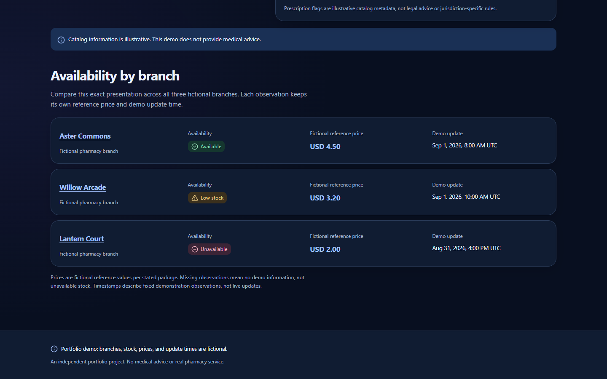
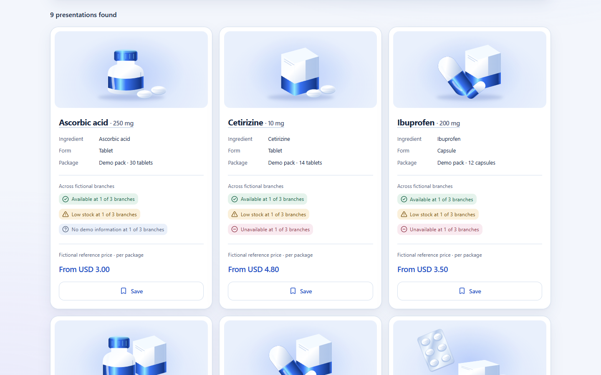
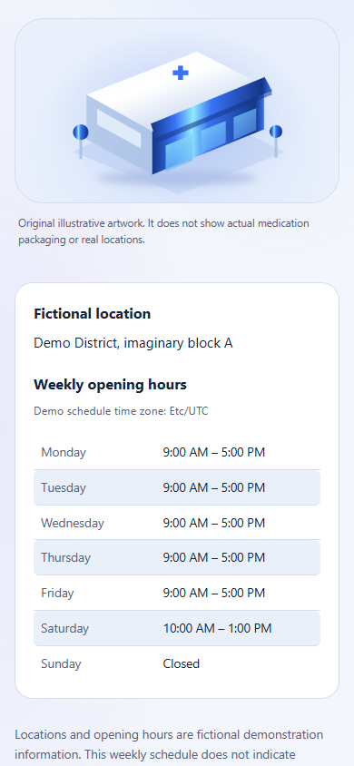
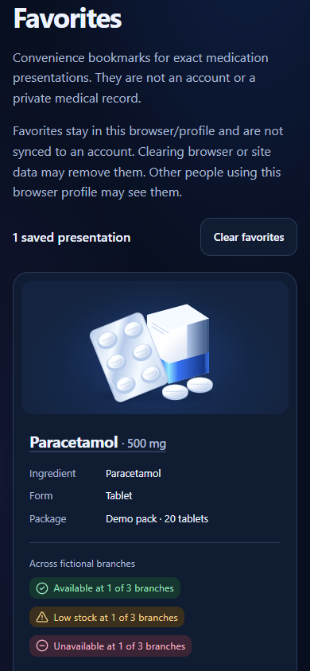
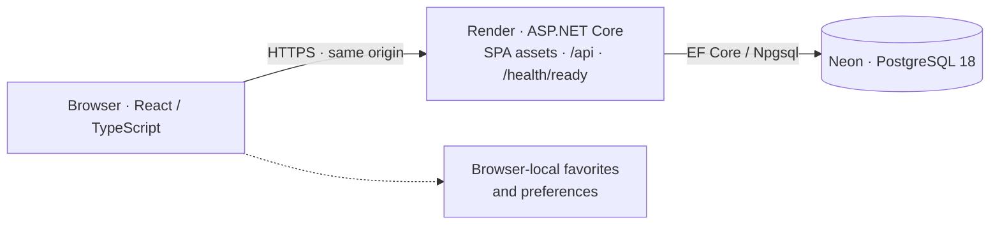

# PharmaFlow

**English** | [Español](README_ES.md) | [日本語](README_JA.md)

**Independent full-stack HealthTech portfolio project.**

React · TypeScript · ASP.NET Core · C# · PostgreSQL · Docker

Explore fictional medication presentations and compare availability across fictional community pharmacy branches. PharmaFlow combines a focused public experience with a read-only API, persistent demonstration data, and an explicit database release workflow.

**[Live Demo](https://pharmaflow-oux0.onrender.com) · [Source Code](https://github.com/YoAndrew21/pharmaflow)**

The demo uses free infrastructure; the first request after inactivity may take longer. All catalog, branch, stock, and reference-price information is demonstration data.

## In the application


*Home — original visual identity, catalog discovery, and a clear fictional-data disclosure.*


*One presentation, three branch observations: availability and reference price remain independent.*

<details>
<summary>Catalog and mobile views</summary>


*Catalog — presentation cards, availability summaries, and reference prices in the light theme.*


*Mobile pharmacy view — a complete weekly schedule, including the closed day.*


*Mobile favorites view — a presentation saved through the public UI, only in that browser.*

</details>

These are real viewport captures of the public demo, not mockups. [Screenshot provenance and reproduction](docs/screenshots/README.md).

## Product experience

- Catalog discovery with normalized name/ingredient search, branch/status/form filters, and name or reference-price sorting.
- Presentation details with branch-by-branch availability, nullable reference prices, and fixed UTC observation times.
- Pharmacy directory and details with fictional locations and deterministic weekly schedules, including closed days and split-interval support.
- Browser-local favorites: save/remove presentations, retain them across reloads, and preserve them during API failures or storage recovery.
- English, Spanish, and Japanese; light/dark themes; responsive layouts; distinct loading, empty, missing-information, not-found, error, and retry states.

## Architecture and stack



React runs in the browser. Vite builds the frontend; ASP.NET Core serves the compiled SPA and API from one origin. PostgreSQL supplies API response data. Favorites and language/theme preferences stay in browser storage.

| Area | Technologies |
| --- | --- |
| Frontend | React, TypeScript, Vite, React Router, CSS Modules, React Aria Components, i18next |
| Backend | ASP.NET Core / C# (.NET 10), Entity Framework Core, Npgsql |
| Database | PostgreSQL 18, hosted on Neon |
| Testing | Vitest, React Testing Library, user-event, xUnit, disposable PostgreSQL 18 Testcontainers |
| Infrastructure | Docker, Render, Neon |

## Domain and engineering decisions

The canonical dataset contains **9 medication presentations, 3 branches, and 21 availability observations**. A medication identifies one concrete strength, form, and package, preserving identity across search, details, and favorites.

- `available`, `low-stock`, and `unavailable` are demo statuses, not live stock quantities.
- A missing observation is **not** unavailable stock. A null reference price is **not** zero; an unavailable observation may still have a reference price.
- Prices are fictional USD values for a package. Formatting follows the locale; currency is not converted. Observation times represent fixed UTC instants.
- The frontend searches, filters, sorts, and summarizes validated API collections. There is no server-side search/filtering or pagination. Collection refetching and the current canonical branch slug/ID assumption remain limitations of this small-catalog implementation.
- Async reads propagate cancellation and keep loading/failure separate from empty results. There is no browser fallback to local canonical records. Favorites are reconciled only after a successful complete authoritative lookup.

## Production and security

The multi-stage Production image runs as non-root and contains the API plus compiled React assets. The web runtime has no Vite server or database-release executable.

The database runtime role is read-only, with SELECT limited to the five application tables. A separate explicit release workflow handles migrations, canonical seeding, and permissions. **Normal Production startup does not migrate, seed, or provision roles.** Server secrets are supplied through environment configuration, never embedded in frontend assets.

The post-release verifier checks the expected database state and runtime permissions. Its `database_release_verification: SAFE` result is an internal automated verification, not an external security certification. `/health/ready` checks database connectivity; it does not replace release verification.

See [Production hosting](docker/PRODUCTION.md) and [database release tooling](docker/DATABASE_RELEASE.md) for technical details.

## Quality, accessibility, and languages

Latest validated snapshot: **281 frontend tests and 360 backend tests passed**, with no failures or skipped tests. This documentation update does not rerun those application suites. Coverage includes UI interactions, async/error behavior, favorites, HTTP contracts, persistence, seeding, permissions, and verification tools. Database integration tests use disposable PostgreSQL 18 containers.

Production image, same-origin React/API delivery, persistence, release permissions, and public workflows have also been validated. No CI or coverage percentage is claimed.

**Designed toward WCAG 2.2 AA**: semantic landmarks, skip navigation, keyboard controls, visible focus, accessible custom selects, textual stock states, loading announcements, skeletons, retry focus continuity, reduced motion, and forced-colors support. This is not a compliance claim or a completed accessibility certification; native 200% zoom and real screen-reader/browser acceptance still require documented manual sign-off.

English is the default/fallback; Spanish and Japanese have authored UI and accessibility resources. Language/theme preferences persist locally. Canonical medication/ingredient and branch names stay stable; USD and UTC values use locale-aware formatting. Search does not perform automatic medical translation.

## Run locally

Install Docker Desktop with Linux containers and Docker Compose, then from the repository root:

```sh
cp .env.example .env
# Set two different new local-only passwords in .env before starting.
docker compose up --build
```

Open [http://localhost:5173](http://localhost:5173). This path needs no host Node, .NET SDK, or PostgreSQL installation. Keep `.env` private and use fresh local credentials. `docker compose down` preserves the database volume.

The [Docker development guide](docker/README.md) covers initialization, logs, rebuilds, and persistence. For direct development and test commands, see the [frontend](frontend/README.md) and [backend](backend/README.md) guides. The release workflow is separate from ordinary local startup.

## Project structure

```text
frontend/                       React application and UI tests
backend/PharmaFlow.Api/          API, persistence, migrations, canonical seed
backend/PharmaFlow.Api.Tests/    Backend and disposable database tests
backend/PharmaFlow.DatabaseRelease/  Explicit release and verification tools
demo-data/                      Single canonical fictional dataset
docker/                         Development and release documentation
docs/screenshots/               Real public-demo captures and provenance
scripts/                        Isolated screenshot automation
Dockerfile.production           Production web image
compose.yaml                    Local development environment
```

[PRODUCT_PLAN.md](PRODUCT_PLAN.md) records the original design and evolution; it is not an exact inventory of the current Production deployment.

## Boundaries and author

Independent work by **Yordan Andres Chavez Barros**. The catalog entries, branches, locations, availability, reference prices, schedules, and prescription flags are fictional demonstration values, with no affiliation to real pharmacies, companies, or municipalities. Generic ingredient names are used for recognition, not as authoritative clinical information.

No medical advice, diagnosis, treatment recommendations, or patient information. No prescribing, dispensing, payment, ERP/WMS, or real pharmacy integration workflows. Favorites are browser bookmarks, not patient records or cloud accounts.

Copyright © 2026 Yordan Andres Chavez Barros. All rights reserved. See [NOTICE.md](NOTICE.md).
