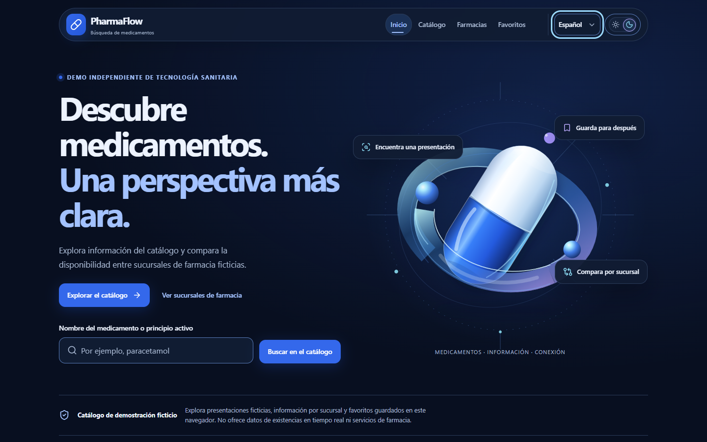
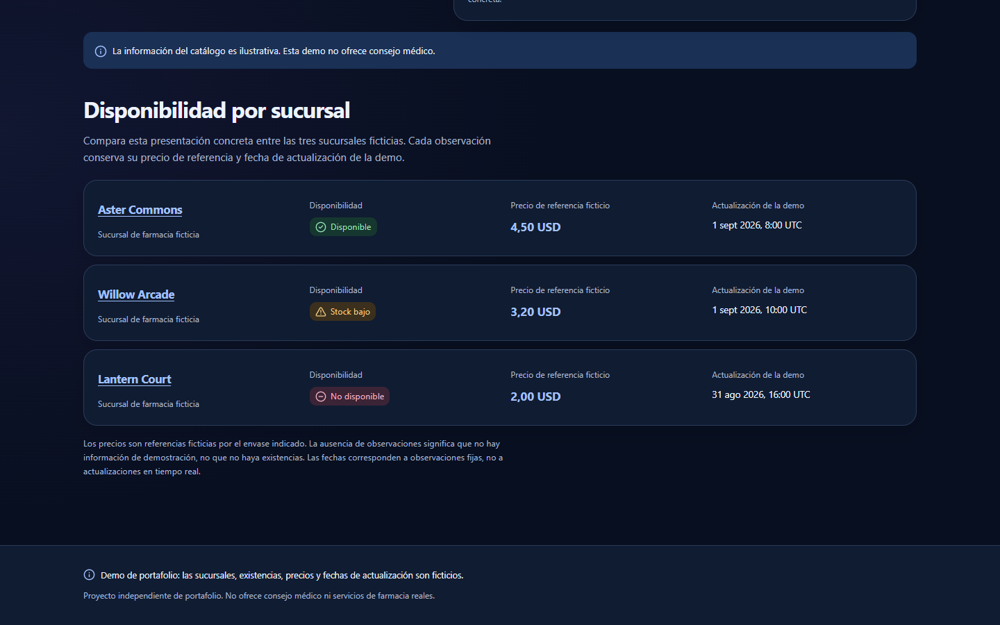
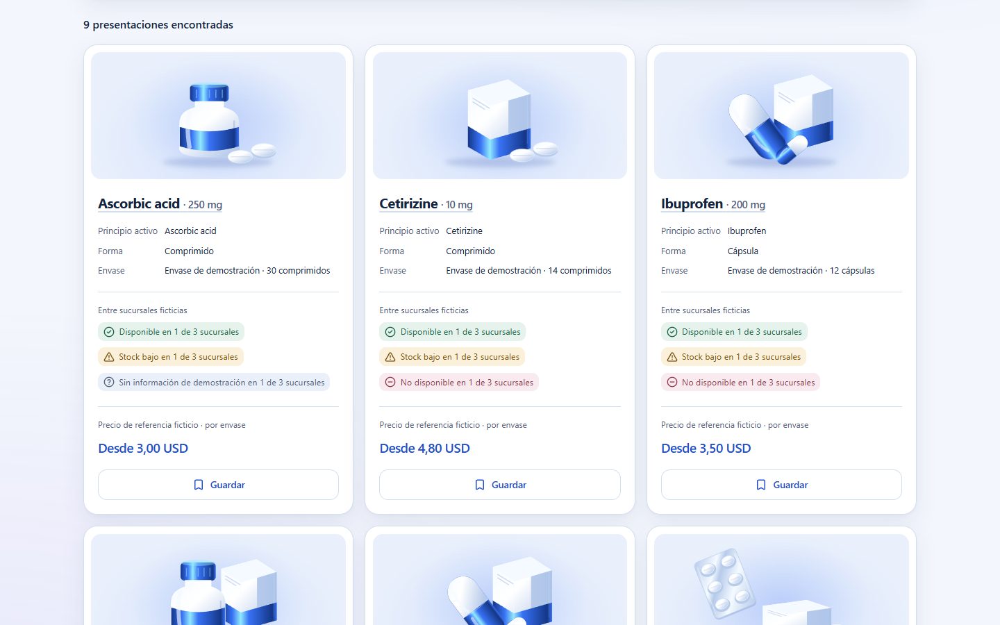
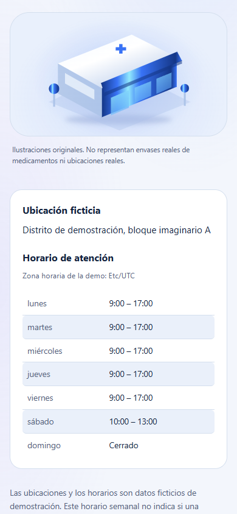
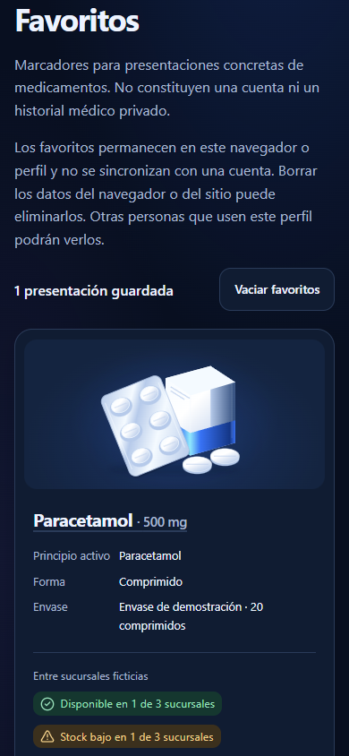
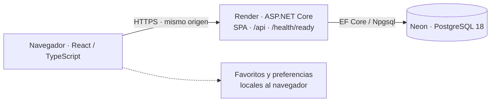

# PharmaFlow

[English](README.md) | **Español** | [日本語](README_JA.md)

**Proyecto independiente de portfolio full-stack en HealthTech.**

React · TypeScript · ASP.NET Core · C# · PostgreSQL · Docker

Explora presentaciones ficticias de medicamentos y compara su disponibilidad entre sucursales ficticias de farmacias comunitarias. PharmaFlow combina una experiencia pública acotada con una API de solo lectura, datos demostrativos persistentes y un proceso explícito de publicación de base de datos.

**[Demo en vivo](https://pharmaflow-oux0.onrender.com) · [Código fuente](https://github.com/YoAndrew21/pharmaflow)**

La demo utiliza infraestructura gratuita; la primera solicitud después de un período de inactividad puede tardar más. La información de catálogo, sucursales, existencias y precios de referencia es demostrativa.

## Dentro de la aplicación


*Inicio — identidad visual original, descubrimiento del catálogo y aviso claro de datos ficticios.*


*Una presentación, tres observaciones por sucursal: disponibilidad y precio de referencia son independientes.*

<details>
<summary>Catálogo y vistas móviles</summary>


*Catálogo — tarjetas de presentaciones, resúmenes de disponibilidad y precios de referencia en tema claro.*


*Detalle de farmacia en móvil — horario semanal completo, incluido el día cerrado.*


*Favoritos en móvil — presentación guardada desde la UI pública, únicamente en ese navegador.*

</details>

Son capturas reales del viewport de la demo pública, no mockups. [Procedencia y reproducción de capturas](docs/screenshots/README.md).

## Experiencia de producto

- Catálogo con búsqueda normalizada por nombre/principio activo, filtros por sucursal/estado/forma y orden por nombre o precio de referencia.
- Detalle de presentación con disponibilidad por sucursal, precios de referencia que admiten null y horas de observación UTC fijas.
- Directorio y detalle de farmacias con ubicaciones ficticias y horarios semanales deterministas, incluidos días cerrados y soporte para intervalos partidos.
- Favoritos locales al navegador: guardar/eliminar presentaciones, conservarlas al recargar y preservarlas ante fallos de API o recuperación del almacenamiento.
- Inglés, español y japonés; temas claro/oscuro; interfaz responsive; estados diferenciados de carga, vacío, información ausente, recurso no encontrado, error y reintento.

## Arquitectura y tecnologías



React se ejecuta en el navegador. Vite compila el frontend; ASP.NET Core sirve la SPA compilada y la API desde un mismo origen. PostgreSQL aporta los datos de respuesta de la API. Favoritos y preferencias de idioma/tema permanecen en el navegador.

| Área | Tecnologías |
| --- | --- |
| Frontend | React, TypeScript, Vite, React Router, CSS Modules, React Aria Components, i18next |
| Backend | ASP.NET Core / C# (.NET 10), Entity Framework Core, Npgsql |
| Base de datos | PostgreSQL 18, alojado en Neon |
| Pruebas | Vitest, React Testing Library, user-event, xUnit, PostgreSQL 18 desechable con Testcontainers |
| Infraestructura | Docker, Render, Neon |

## Decisiones de dominio e ingeniería

El dataset canónico contiene **9 presentaciones, 3 sucursales y 21 observaciones de disponibilidad**. Cada medicamento identifica una concentración, forma y envase concretos, conservando su identidad en búsqueda, detalle y favoritos.

- `available`, `low-stock` y `unavailable` son estados demo, no cantidades de stock en tiempo real.
- Una observación ausente **no** equivale a falta de stock. Un precio de referencia null **no** es cero; una observación sin disponibilidad puede conservar su precio de referencia.
- Los precios son valores ficticios en USD por envase. Su formato depende del idioma; no se convierten monedas. Las observaciones representan instantes UTC fijos.
- El frontend busca, filtra, ordena y resume colecciones validadas de la API. No hay búsqueda/filtros del lado servidor ni paginación. La recarga de colecciones y la suposición actual sobre slug/ID de sucursales canónicas son limitaciones de esta implementación para un catálogo pequeño.
- Las lecturas asíncronas propagan cancelación y separan carga/error de resultados vacíos. No existe fallback a registros canónicos locales en el navegador. Los favoritos solo se reconcilian después de una consulta autoritativa completa y exitosa.

## Producción y seguridad

La imagen Production multietapa se ejecuta sin root y contiene la API y los recursos React compilados. El runtime web no incorpora servidor Vite ni ejecutable de publicación de base de datos.

El rol de base de datos del runtime es de solo lectura, con SELECT limitado a las cinco tablas de aplicación. Un flujo explícito separado realiza migraciones, seed canónico y permisos. **El inicio normal de Production no ejecuta migraciones, seed ni aprovisionamiento de roles.** Los secretos del servidor se suministran mediante configuración de entorno y nunca se incluyen en los recursos del frontend.

El verificador posterior al release comprueba el estado esperado de la base y los permisos del runtime. `database_release_verification: SAFE` es una verificación interna automatizada, no una certificación externa de seguridad. `/health/ready` comprueba conectividad; no sustituye esa verificación.

Detalles técnicos en [hosting Production](docker/PRODUCTION.md) y [herramientas de database release](docker/DATABASE_RELEASE.md).

## Calidad, accesibilidad e idiomas

Último snapshot validado: **281 tests frontend y 360 tests backend aprobados**, sin fallos ni tests omitidos. Esta actualización documental no repite esas suites. Se cubren interacciones, comportamiento asíncrono/errores, favoritos, contratos HTTP, persistencia, seed, permisos y verificadores. Las pruebas de integración utilizan contenedores PostgreSQL 18 desechables.

También se validaron imagen Production, entrega React/API same-origin, persistencia, permisos del release y flujos públicos. No se afirma disponer de CI ni de un porcentaje de cobertura.

**Diseñado con WCAG 2.2 AA como objetivo**: landmarks semánticos, salto al contenido, controles por teclado, foco visible, selects accesibles, estados de stock con texto, anuncios de carga, skeletons, continuidad del foco al reintentar, reduced motion y forced colors. No constituye una afirmación de conformidad ni una certificación completa; la aceptación con zoom nativo al 200% y lector de pantalla/navegador real aún requiere validación manual documentada.

El inglés es predeterminado/fallback; español y japonés cuentan con recursos de interfaz y accesibilidad redactados explícitamente. Idioma/tema persisten localmente. Los nombres canónicos de medicamentos/principios activos y sucursales permanecen estables; USD y UTC se formatean según el idioma. La búsqueda no realiza traducción médica automática.

## Ejecutar localmente

Instala Docker Desktop con contenedores Linux y Docker Compose. Desde la raíz:

```sh
cp .env.example .env
# Define dos contraseñas nuevas, distintas y solo locales en .env antes de iniciar.
docker compose up --build
```

Abre [http://localhost:5173](http://localhost:5173). Esta vía no requiere instalar Node, SDK .NET ni PostgreSQL en el host. Mantén `.env` privado y usa credenciales locales nuevas. `docker compose down` conserva el volumen de datos.

La [guía Docker de desarrollo](docker/README.md) explica inicialización, logs, reconstrucción y persistencia. Para desarrollo directo y comandos de pruebas, consulta [frontend](frontend/README.md) y [backend](backend/README.md). El database release está separado del inicio local habitual.

## Estructura

```text
frontend/                       Aplicación React y tests de UI
backend/PharmaFlow.Api/          API, persistencia, migraciones y seed canónico
backend/PharmaFlow.Api.Tests/    Tests backend y bases desechables
backend/PharmaFlow.DatabaseRelease/  Release explícito y verificadores
demo-data/                      Único dataset ficticio canónico
docker/                         Documentación de desarrollo y release
docs/screenshots/               Capturas reales y su procedencia
scripts/                        Automatización aislada de capturas
Dockerfile.production           Imagen web Production
compose.yaml                    Entorno de desarrollo local
```

[PRODUCT_PLAN.md](PRODUCT_PLAN.md) registra el diseño original y su evolución; no es un inventario exacto del despliegue Production actual.

## Límites y autor

Trabajo independiente de **Yordan Andres Chavez Barros**. Entradas del catálogo, sucursales, ubicaciones, disponibilidad, precios de referencia, horarios e indicadores de prescripción son valores demostrativos ficticios, sin relación con farmacias, empresas ni municipalidades reales. Los nombres genéricos de ingredientes permiten reconocerlos; no son información clínica autoritativa.

No ofrece consejo médico, diagnóstico ni recomendaciones de tratamiento, ni maneja información de pacientes. No incluye prescripción, dispensación, pagos, ERP/WMS ni integración con farmacias reales. Los favoritos son marcadores del navegador, no historias clínicas ni cuentas en la nube.

Copyright © 2026 Yordan Andres Chavez Barros. All rights reserved. Consulta [NOTICE.md](NOTICE.md).
