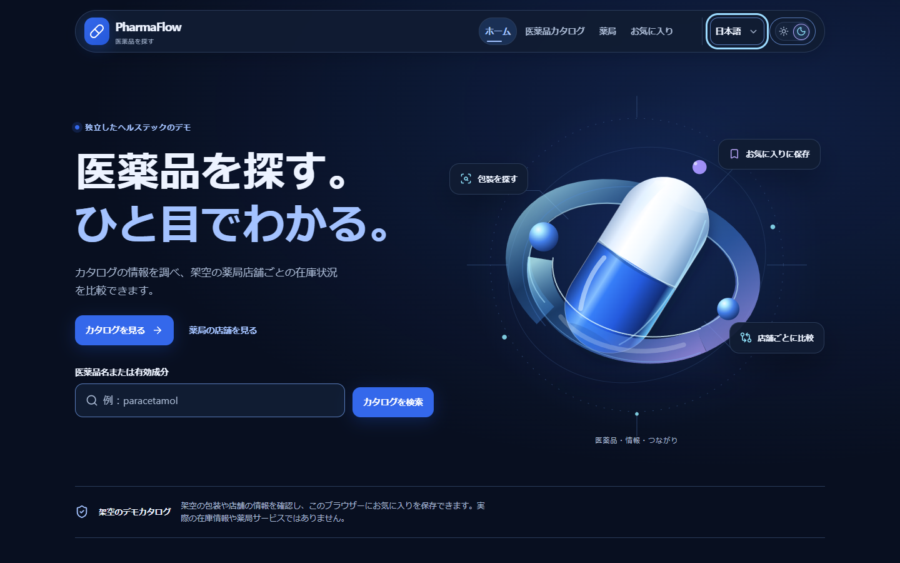
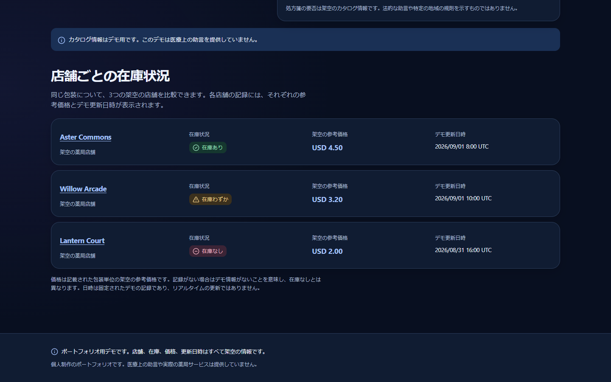
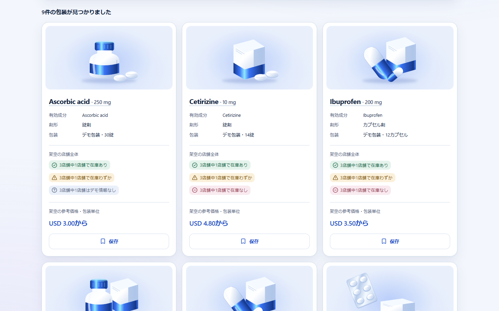
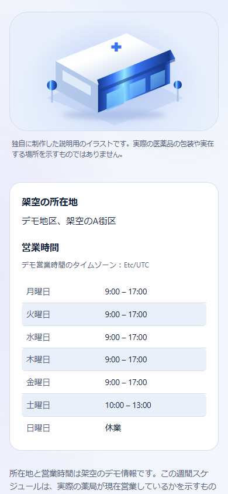
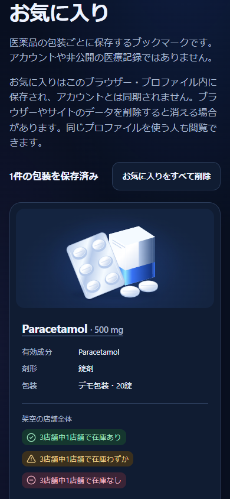
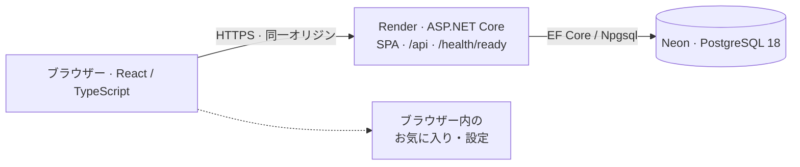

# PharmaFlow

[English](README.md) | [Español](README_ES.md) | **日本語**

**ヘルステック分野を題材にした、独立制作のフルスタック・ポートフォリオプロジェクト。**

React · TypeScript · ASP.NET Core · C# · PostgreSQL · Docker

医薬品の規格・剤形・包装ごとのカタログ項目を探し、地域の薬局を想定した架空の店舗間で在庫状況を比較できます。用途を絞った公開UI、読み取り専用API、デモデータの永続化、明示的なデータベースリリース処理を一つの構成にまとめています。

**[公開デモ](https://pharmaflow-oux0.onrender.com) · [ソースコード](https://github.com/YoAndrew21/pharmaflow)**

無料インフラを利用しているため、しばらくアクセスがなかった後の初回応答には時間がかかる場合があります。カタログ情報、店舗、在庫状況、参考価格はデモ用の架空データです。

## 画面紹介


*ホーム画面：独自のビジュアル、カタログ検索、架空データであることを伝える表示。*


*同じ規格・包装に対する3店舗のデータ。在庫状況と参考価格を別々の情報として扱います。*

<details>
<summary>カタログとモバイル画面</summary>


*カタログ：ライトテーマのカード表示、在庫状況の要約、参考価格。*


*日本語のモバイル画面：休業日を含む1週間の営業時間。*


*日本語のモバイル画面：公開UIから保存した項目。保存先はそのブラウザー内のみです。*

</details>

画像は公開デモを実際に操作して取得したビューポートのキャプチャです。モックアップではありません。[撮影方法と再生成手順](docs/screenshots/README.md)。

## 主な機能

- 医薬品名・有効成分名の正規化検索、店舗・在庫状況・剤形による絞り込み、名称・参考価格による並べ替え。
- 規格・包装単位の詳細と店舗別の在庫状況。参考価格の未設定と、固定のUTC更新日時を表現。
- 架空の所在地を持つ店舗一覧・詳細。休業日や1日に複数の時間帯を扱える、固定の週間スケジュール。
- ブラウザー内に保存するお気に入り。追加・削除・再読み込み後の保持に対応し、API障害やストレージの復旧時も保存内容を保護。
- 英語・スペイン語・日本語、ライト／ダークテーマ、レスポンシブ表示。読み込み中、検索結果なし、デモ情報なし、404、エラー、再試行を区別。

## アーキテクチャと技術構成



Reactはブラウザー上で動作します。Viteはフロントエンドのビルドに使用し、ASP.NET Coreがビルド済みSPAとAPIを同一オリジンで配信します。APIの応答データはPostgreSQLから取得します。お気に入り、言語、テーマの設定はブラウザー内に保存します。

| 領域 | 技術 |
| --- | --- |
| フロントエンド | React, TypeScript, Vite, React Router, CSS Modules, React Aria Components, i18next |
| バックエンド | ASP.NET Core / C# (.NET 10), Entity Framework Core, Npgsql |
| データベース | PostgreSQL 18、Neonでホスト |
| テスト | Vitest, React Testing Library, user-event, xUnit, Testcontainersによる使い捨てのPostgreSQL 18 |
| インフラ | Docker, Render, Neon |

## ドメインと設計上の判断

正本のデータセットは、**医薬品のカタログ項目9件、店舗3件、在庫状況の観測データ21件**です。Medicationは成分名だけではなく、特定の規格・剤形・包装を表します。検索、詳細、お気に入りでも同じ識別子を使います。

- `available`、`low-stock`、`unavailable`はデモ上の状態です。リアルタイムの在庫数量ではありません。
- 観測データがない場合は「在庫なし」ではなく「デモ情報なし」です。参考価格のnullは0 USDを意味しません。在庫なしの観測データにも参考価格が残る場合があります。
- 価格は包装単位の、デモ用の架空の参考価格（USD）です。表示形式は言語に合わせますが、通貨換算は行いません。日時は固定のUTC時刻です。
- 検索・絞り込み・並べ替え・集計は、APIから取得・検証したコレクションに対してフロントエンドで行います。サーバー側検索・絞り込みやページネーションはありません。コレクションの再取得と、現在の正本データにおける店舗slug／IDの対応関係への依存は、小規模カタログ向け実装の制約です。
- 非同期読み取りはキャンセルを伝播し、読み込み・失敗を検索結果なしと区別します。障害時にブラウザー内の正本レコードへ切り替える処理はありません。お気に入りの未知のIDを整理するのは、完全な正規データの取得に成功した後だけです。

## 本番構成とセキュリティ

マルチステージのProductionイメージは非rootで動作し、APIとビルド済みReactアセットを含みます。WebランタイムにはViteサーバーやデータベースリリース用の実行ファイルを含めません。

ランタイムのデータベースロールは読み取り専用で、SELECTの対象をアプリケーションの5テーブルに限定します。マイグレーション、正本データの投入、権限設定は、別の明示的なリリース処理で実施します。**通常のProduction起動では、マイグレーション、データ投入、ロールの作成を実行しません。** サーバーのシークレットは環境設定から渡し、フロントエンドのアセットには埋め込みません。

リリース後の検証ツールは、想定するデータベースの状態とランタイム権限を確認します。`database_release_verification: SAFE`は内部の自動検証結果であり、外部機関によるセキュリティ認証ではありません。`/health/ready`は接続確認であり、リリース検証の代わりにはなりません。

技術的な手順は[Production構成](docker/PRODUCTION.md)と[データベースリリース](docker/DATABASE_RELEASE.md)を参照してください。

## 品質・アクセシビリティ・多言語対応

直近の検証記録では、**フロントエンド281件、バックエンド360件のテストが成功**し、失敗・スキップはありません。このドキュメント更新ではアプリケーションのテストスイートを再実行していません。操作、非同期処理・エラー、お気に入り、HTTP契約、永続化、データ投入、権限、検証ツールを対象としています。DB統合テストは使い捨てのPostgreSQL 18コンテナーで実行します。

Productionイメージ、React/APIの同一オリジン配信、永続化、リリース権限、公開環境の操作フローも検証済みです。CIやカバレッジ率の実績は主張していません。

**WCAG 2.2 AAを目標に設計**しています。セマンティックなランドマーク、本文へのスキップリンク、キーボード操作、見えるフォーカス、アクセシブルなSelect、文字による在庫状況、読み込み通知、スケルトン、再試行時のフォーカス維持、動きの抑制、強制カラーモードに対応しています。準拠や認証取得を表すものではありません。ブラウザー標準の200%ズームと、実際のスクリーンリーダー／ブラウザーでの受け入れ確認は、引き続き手動検証の記録が必要です。

英語が既定・フォールバック言語です。スペイン語と日本語には、画面文言とアクセシビリティ用文言を個別に用意しています。言語・テーマ設定はローカルに保持します。正本の医薬品名・成分名・店舗名は変更せず、USD・UTCの表示形式を言語に合わせます。検索で医学用語を自動翻訳する機能はありません。

## ローカルで実行

LinuxコンテナーとDocker Composeを使えるDocker Desktopを用意し、リポジトリのルートで実行します。

```sh
cp .env.example .env
# 起動前に.envへ、ローカル専用の新しいパスワードを2つ、別々の値で設定します。
docker compose up --build
```

[http://localhost:5173](http://localhost:5173)を開きます。この方法ではホストへのNode、.NET SDK、PostgreSQLのインストールは不要です。`.env`は非公開にし、本番とは別のローカル用認証情報を使ってください。`docker compose down`でもデータボリュームは保持されます。

初期化、ログ、再ビルド、永続化は[Docker開発ガイド](docker/README.md)にまとめています。コンテナーを使わない開発やテストコマンドは[frontend](frontend/README.md)と[backend](backend/README.md)を参照してください。データベースリリースは通常のローカル起動とは別の処理です。

## プロジェクト構成

```text
frontend/                       Reactアプリケーション・UIテスト
backend/PharmaFlow.Api/          API・永続化・マイグレーション・正本データ投入
backend/PharmaFlow.Api.Tests/    バックエンド・使い捨てDBのテスト
backend/PharmaFlow.DatabaseRelease/  明示的なリリース・検証ツール
demo-data/                      架空データの唯一の正本
docker/                         開発・リリースのドキュメント
docs/screenshots/               公開デモの実画面と撮影記録
scripts/                        アプリから独立した撮影スクリプト
Dockerfile.production           本番Webイメージ
compose.yaml                    ローカル開発環境
```

[PRODUCT_PLAN.md](PRODUCT_PLAN.md)は当初の設計とその変遷を記録したものであり、現在のProduction構成を厳密に列挙した文書ではありません。

## プロジェクトの範囲と作者

**Yordan Andres Chavez Barros**による独立制作です。掲載するカタログ情報、店舗、所在地、在庫状況、参考価格、営業時間、処方区分のフラグはすべてデモ用の架空データです。実在する薬局・企業・自治体とは関係ありません。一般的な成分名は認識しやすくするために使用しており、臨床上の正確性を保証する情報ではありません。

医療上の助言、診断、治療の提案を行うものではなく、患者情報を扱いません。処方、調剤、決済、ERP/WMSや実在の薬局との連携機能はありません。お気に入りはブラウザーのブックマークであり、診療記録やクラウドアカウントではありません。

Copyright © 2026 Yordan Andres Chavez Barros. All rights reserved. [NOTICE.md](NOTICE.md)を参照してください。
